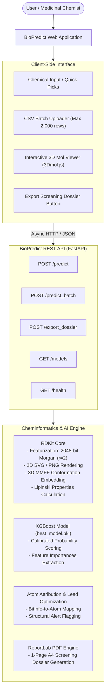

# BioPredict: In Silico Bioactive Molecule Prediction Platform

> **An AI-Driven Cheminformatics & Virtual Screening System for Selective Cyclooxygenase-2 (COX-2) Inhibitors.**

[](https://www.python.org/)
[](https://fastapi.tiangolo.com/)
[](https://www.rdkit.org/)
[](https://xgboost.ai/)
[](https://www.reportlab.com/)
[](https://3dmol.org/)

---

## 🔬 Executive Summary & Scientific Background

Drug discovery is traditionally an arduous, capital-intensive endeavor spanning 10–15 years and over $2.6 billion per approved therapeutic, with more than 90% of candidates failing in clinical trials due to lack of efficacy or off-target toxicity. Computational **in silico virtual screening** prioritizes candidate molecules before physical wet-lab synthesis, cutting early-stage hit-finding timelines from months to seconds.

**BioPredict** focuses on the therapeutic target **Cyclooxygenase-2 (COX-2 / PTGS2)** (ChEMBL Target ID: **[CHEMBL230](https://www.ebi.ac.uk/chembl/target_report_card/CHEMBL230/)**):
* **Biological Function:** An inducible homodimeric enzyme responsible for converting arachidonic acid into pro-inflammatory prostaglandins that mediate inflammation and pain.
* **Clinical Significance:** Classical non-steroidal anti-inflammatory drugs (NSAIDs) like Aspirin and Ibuprofen non-selectively inhibit both COX-1 and COX-2, leading to gastrointestinal ulceration and bleeding due to suppression of protective gastric prostaglandins.
* **The In Silico Goal:** Identify selective COX-2 inhibitors (such as Celecoxib) that bind the hydrophilic side pocket of COX-2 while sparing constitutive COX-1.

BioPredict combines **2048-bit Morgan circular fingerprints (ECFP4)** with an optimized **XGBoost Classifier**, delivering real-time bioactivity classification, Explainable AI (XAI) atom attribution, lead optimization suggestions, and downloadable publication-grade screening dossiers.

---

## ✨ Core Platform Capabilities

### 1. Dual-Mode Chemical Input Resolution
* **Direct SMILES:** Canonical and non-canonical SMILES notation (e.g. `CC1=CC=C(C=C1)C1=CC(=NN1C1=CC=C(C=C1)S(N)(=O)=O)C(F)(F)F`).
* **Common & Drug Names:** Automatic lookup for standard pharmaceutical names (`Celecoxib`, `Rofecoxib`, `Diclofenac`, `Aspirin`, `Ibuprofen`, `Caffeine`) with NCBI PubChem PUG REST API fallback.

### 2. Explainable AI (XAI) & Atom Attribution
* Deconstructs the XGBoost decision process by matching active Morgan fingerprint bits back to their originating atomic centers.
* Highlights key pharmacophore substructures:
  * **Sulfonamide Anchor:** Essential for binding into the secondary hydrophilic side pocket of COX-2.
  * **Trifluoromethyl Group:** Promotes hydrophobic channel insertion.
  * **Aromatic Cores:** Engage in $\pi$–$\pi$ stacking with active site residues.
* Real-time 3D gold-atom highlighting corresponds directly to the highest-scoring attribution fragments.

### 3. Lead Optimization Engine
* When a molecule is evaluated as **Inactive**, the platform analyzes its molecular topology and structural descriptors.
* Generates actionable medicinal chemistry recommendations to guide SAR (Structure-Activity Relationship) exploration toward nanomolar affinity.

### 4. Exportable 1-Page Screening Dossier (PDF)
* Generates a formal, 1-page **Bioactivity Screening Dossier** on demand.
* Contains:
  * Compound Name and Canonical SMILES (word-wrapped).
  * Color-coded verdict badge (`ACTIVE` / `INACTIVE`) with percentage confidence score.
  * Publication-quality 2D chemical structure generated on-the-fly via RDKit.
  * Physicochemical profile & Lipinski's Rule of 5 compliance check (MW, LogP, HBD, HBA, rotatable bonds).
  * Key structural alerts and feature contribution weights.
  * Exact screening date and UTC timestamp.

### 5. High-Throughput Batch Library Screening
* Screens libraries of up to **2,000 compounds** per CSV upload.
* **Client-side row validation:** Instant notification if a file exceeds 2,000 rows without server roundtrips.
* **Server-side safety truncation:** Protects the cloud backend from out-of-memory states.
* Interactive filter controls (`All`, `Active`, `Inactive`) with real-time active hit-rate calculations and one-click annotated CSV export.

### 6. Interactive 3D Conformation Modeling
* Automated 3D coordinate generation via RDKit with MMFF94 force-field geometry minimization.
* Hardware-accelerated WebGL rendering via `3Dmol.js` with **Ball & Stick** and **Stick** representation modes.
* Standard CPK atomic color scheme with selective highlighting for key pharmacophore atoms.

---

## 🏗️ System Architecture



---

## 🧪 Machine Learning Pipeline & Benchmark

### 1. Dataset & Preprocessing
* **Source:** ChEMBL Database (Target: Human COX-2 / CHEMBL230).
* **Bioactivity Metric:** $\text{IC}_{50}$ normalized to nanomolar ($\text{nM}$).
* **Binary Activity Threshold:**
  * **Active:** $\text{IC}_{50} \le 1,000\text{ nM}$ ($1.0\ \mu\text{M}$ / $\text{pIC}_{50} \ge 6.0$).
  * **Inactive:** $\text{IC}_{50} > 1,000\text{ nM}$.
* **Curation:** SMILES canonicalization, salt stripping, charge neutralization, and duplicate resolution.

### 2. Featurization
* **Fingerprint:** Morgan Circular Fingerprints (ECFP4 equivalent).
* **Radius:** $r = 2$ folded into a fixed **2048-bit bit-vector**.
* **Rationale:** Effectively encodes circular atomic environments, branching patterns, aromaticity, and hydrogen-bonding topologies.

### 3. Model Benchmark Results
Evaluated using 10-fold molecule-aware cross-validation and an independent holdout test split:

| Model | CV Accuracy | CV ROC-AUC | Holdout Accuracy | Holdout ROC-AUC | Holdout F1-Score |
| :--- | :---: | :---: | :---: | :---: | :---: |
| **XGBoost (Primary Engine)** | **82.2%** | **0.901** | **83.1%** | **0.908** | **0.842** |
| **Random Forest** | 80.9% | 0.887 | 81.4% | 0.892 | 0.825 |
| **Support Vector Classifier (SVC)** | 79.5% | 0.871 | 80.2% | 0.876 | 0.811 |
| **Artificial Neural Network (ANN)** | 78.4% | 0.859 | 79.0% | 0.863 | 0.798 |
| **Radial Basis Function (RBF)** | 77.1% | 0.842 | 77.8% | 0.849 | 0.783 |
| **Naive Bayes** | 71.3% | 0.780 | 72.0% | 0.785 | 0.730 |

*XGBoost was selected as the production model due to its top discriminative AUC performance, fast inference speed (<10 ms), and tree-based feature interpretability.*

---

## 📡 REST API Endpoints

| Method | Endpoint | Description | Payload / Parameters |
| :---: | :--- | :--- | :--- |
| `GET` | `/health` | Live service health check & model readiness | None |
| `POST` | `/predict` | Single molecule prediction with XAI attribution | `{"smiles": "Celecoxib"}` |
| `POST` | `/predict_batch` | Batch virtual screening (max 2,000 rows) | Multipart Form: `.csv` file with `smiles` column |
| `POST` | `/export_dossier` | Generates downloadable 1-page PDF dossier | `{"smiles": "...", "molecule_name": "...", ...}` |
| `POST` | `/visualize` | Generates 2D molecular structure SVG | `{"smiles": "...", "width": 400, "height": 300}` |
| `GET` | `/models` | Comprehensive leaderboard metrics & confusion matrices | None |

---

## 🎨 Molecular Color Legend (CPK Standard)

The 3D interactive viewer implements standard CPK atomic coloring:

| Atom | Element | Color Code | Representation in Viewer |
| :---: | :---: | :---: | :---: |
| **C** | Carbon | Slate Grey (`#5A6065`) | Ball / Stick |
| **H** | Hydrogen | Pure White (`#FFFFFF`) | Small Sphere |
| **O** | Oxygen | Crimson Red (`#E53935`) | Ball / Stick |
| **N** | Nitrogen | Deep Blue (`#1E88E5`) | Ball / Stick |
| **S** | Sulfur | Amber Yellow (`#FBC02D`) | Ball / Stick |
| **F, Cl** | Halogens | Vibrant Green (`#43A047`) | Ball / Stick |
| **Key** | **Attributed Pharmacophore** | **Vibrant Gold (`#F59E0B`)** | **Enlarged Highlighted Atoms** |

---

## 📂 Project Organization

```text
Bioactive_molecule_prediction/
├── README.md                               # Production system documentation
├── data/
│   ├── CHEMBL230_RAW_DATA.csv              # Curated ChEMBL230 bioactivity records
│   └── CHEMBL230_Preprocessed_Data.csv     # Preprocessed baseline dataset
├── version 1.2/                            # Deployed production package
│   ├── backend/
│   │   ├── main.py                         # FastAPI web service & prediction endpoints
│   │   ├── dossier_generator.py            # ReportLab 1-page PDF dossier generator
│   │   └── model/
│   │       ├── best_model.pkl              # Serialized XGBoost model binary
│   │       ├── metadata.json               # Training parameters, thresholds & split scores
│   │       └── confusion_matrices.json     # Multi-model evaluation confusion matrices
│   ├── frontend/
│   │   ├── index.html                      # Single Page Application interface
│   │   ├── style.css                       # Modern CSS3 styling (zero blur, GPU-efficient)
│   │   ├── script.js                       # Frontend controllers & state managers
│   │   ├── hero-molecule.js                # Lightweight 2D canvas molecular dynamics
│   │   └── assets/                         # Visual assets & figures
│   ├── CHEMBL230_Preprocessed_Data_V2.csv  # Final normalized training dataset
│   ├── ML_Pipeline_Final.ipynb             # Model training & cross-validation notebook
│   ├── cv_results.csv                      # Cross-validation metrics table
│   ├── holdout_results.csv                 # Holdout test set metrics table
│   ├── sample_molecules.csv                # Sample batch evaluation library
│   └── requirements.txt                    # Pinned Python package dependencies
└── version-1/                              # Legacy initial prototype (v1.0)
```

---

## 📖 Scientific References

1. **Mustapha, M. S., & Saeed, F.** (2016). *Bioactivity Prediction of Cyclooxygenase-2 Inhibitors Using Machine Learning Approaches*. Molecules, 21(5), 618.
2. **Rogers, D., & Hahn, M.** (2010). *Extended-Connectivity Fingerprints*. Journal of Chemical Information and Modeling, 50(5), 742–754.
3. **Chen, T., & Guestrin, C.** (2016). *XGBoost: A Scalable Tree Boosting System*. Proceedings of the 22nd ACM SIGKDD International Conference on Knowledge Discovery and Data Mining.
4. **Landrum, G.** (2024). *RDKit: Open-source cheminformatics toolkit*. [https://www.rdkit.org](https://www.rdkit.org).
5. **Gaulton, A., et al.** (2017). *The ChEMBL database in 2017*. Nucleic Acids Research, 45(D1), D945–D954.

---

*BioPredict is designed strictly for research, pharmaceutical screening, and educational applications.*
